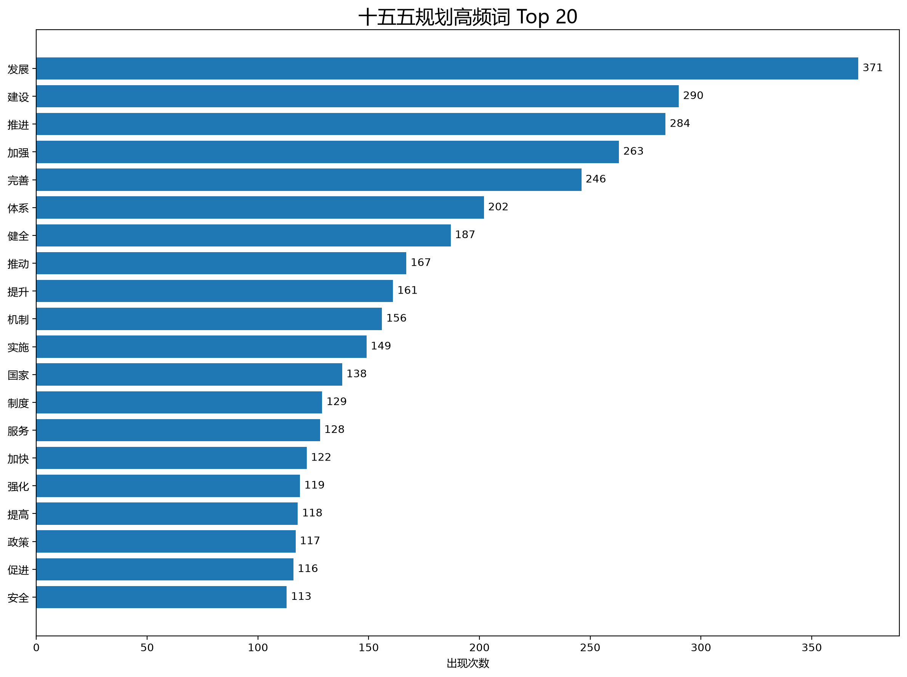

# “十五五”发展规划文本热词频率统计与词云可视化

## 一、项目简介

本项目是 Python 程序设计课程的实验作业，要求编写程序，统计“十五五”发展规划报告中的热词频率。

项目使用 Python 读取“十五五”规划文本，通过 jieba 中文分词库对文章进行分词，利用 Counter 统计词语出现次数，并使用 Matplotlib 和 WordCloud 生成热词柱状图及中文词云。

实验还将词频统计结果保存为 CSV 文件，方便后续查看和分析。

## 二、实验目的

1. 学习使用 Python 读取和处理中文文本。
2. 掌握 jieba 中文分词的基本方法。
3. 学习使用 Counter 统计词语出现次数。
4. 掌握使用 Pandas 保存词频统计结果的方法。
5. 学习使用 Matplotlib 绘制热词统计柱状图。
6. 学习使用 WordCloud 生成中文词云图。
7. 进一步熟悉 Python 项目的开发、测试和 GitHub 版本管理过程。

## 三、开发环境

| 项目 | 开发环境 |
|---|---|
| 操作系统 | Windows |
| 编程语言 | Python 3.14 |
| 开发工具 | Visual Studio Code |
| 中文分词 | jieba |
| 数据统计 | collections.Counter |
| 数据处理 | Pandas |
| 数据可视化 | Matplotlib |
| 词云生成 | WordCloud |
| 版本管理 | Git、GitHub |

## 四、项目结构

```text
Python-15th-Five-Year-Plan-Word-Frequency/
├── data/
│   └── plan.txt
├── images/
│   ├── top20_words.png
│   └── wordcloud.png
├── results/
│   └── word_frequency.csv
├── main.py
├── requirements.txt
└── README.md
```

## 五、实验原理

### 1. 文本读取

使用 Python 的文件读取功能，将规划文本加载到程序中。

### 2. 中文分词

使用 jieba 将连续的中文文本分割成词语。

为了减少专业词语被错误拆分的情况，程序还添加了部分自定义词汇，例如“十五五”“高质量发展”“新质生产力”“科技创新”等。

### 3. 数据清洗

对分词结果进行筛选，主要包括：

- 删除长度小于两个字符的词语。
- 过滤标点符号、数字和非中文内容。
- 删除部分常见停用词。
- 保留用于后续统计的有效中文词语。

### 4. 词频统计

使用 Python 的 Counter 统计每个词语的出现次数。

计算方法：

词频占比 = 某词语出现次数 ÷ 有效分词总数 × 100%

然后按照出现次数从高到低排列，输出前 20 个高频词。

### 5. 可视化展示

使用 Matplotlib 绘制前 20 个高频词的横向柱状图。

使用 WordCloud 根据词语出现次数生成中文词云图，词语出现次数越多，在词云中通常显示得越大。

## 六、实验运行方法

### 1. 安装依赖

```bash
python -m pip install -r requirements.txt
```

### 2. 运行词频统计程序

```bash
python main.py
```

### 3. 查看运行结果

程序运行完成后，会生成三个主要文件：

- `results/word_frequency.csv`：完整词频统计结果。
- `images/top20_words.png`：Top 20 高频词柱状图。
- `images/wordcloud.png`：中文词云图。

## 七、实验统计结果

本次实验使用的规划文本包含 62,639 个字符。

经过中文分词和停用词过滤，程序统计得到以下前 20 个高频词：

| 排名 | 热词 | 出现次数 |
|---:|---|---:|
| 1 | 发展 | 371 |
| 2 | 建设 | 290 |
| 3 | 推进 | 284 |
| 4 | 加强 | 263 |
| 5 | 完善 | 246 |
| 6 | 体系 | 202 |
| 7 | 健全 | 187 |
| 8 | 推动 | 167 |
| 9 | 提升 | 161 |
| 10 | 机制 | 156 |
| 11 | 实施 | 149 |
| 12 | 国家 | 138 |
| 13 | 制度 | 129 |
| 14 | 服务 | 128 |
| 15 | 加快 | 122 |
| 16 | 强化 | 119 |
| 17 | 提高 | 118 |
| 18 | 政策 | 117 |
| 19 | 促进 | 116 |
| 20 | 安全 | 113 |

以上为本次程序在当前文本和分词规则下生成的结果。

## 八、实验可视化结果

### 1. 热词 Top 20 柱状图



### 2. 中文词云图


## 九、结果分析

从统计结果来看，“发展”出现次数最多，共 371 次；其次是“建设”和“推进”，分别出现 290 次和 284 次。

另外，“加强”“完善”“健全”“推动”“提升”等词语出现频率也比较高。

这些高频词反映出规划文本中较多涉及发展任务、建设目标以及各项政策措施。

同时，“体系”“机制”“制度”“服务”和“安全”等词语也有较高频率，说明文本中包含制度建设、公共服务和安全保障等相关内容。

需要注意，词语出现频率只能反映其在文本中使用的次数，不能完全代表政策的重要程度。

## 十、实验中遇到的问题

### 1. 文件夹创建错误

在创建项目目录时，最初将 `images` 和 `results` 错误创建成普通文件，导致程序运行时出现 `FileExistsError`。

后来通过重命名原文件，再创建真正的文件夹解决了问题。

### 2. 中文字体显示问题

由于 Matplotlib 和 WordCloud 需要正确配置中文字体，程序通过查找 Windows 系统字体文件，使柱状图和词云中的中文能够正常显示。

### 3. 词频统计规则

中文文本不能像英文一样直接使用空格分词，因此需要使用 jieba 进行中文分词。

为了使统计结果更合理，程序还加入了自定义词语和停用词过滤规则。

## 十一、实验收获

通过本次实验，我学习了如何使用 Python 对较长的中文文本进行处理，并掌握了 jieba 中文分词和 Counter 词频统计的基本使用方法。

在编写程序的过程中，我进一步熟悉了文件读取、循环、条件判断、列表和字典等 Python 基础知识。

在生成可视化图表时，我学会了使用 Matplotlib 绘制柱状图，并通过 WordCloud 将词频结果展示成中文词云，使原本比较枯燥的数据变得更加直观。

此外，我也认识到数据处理需要考虑分词准确性、停用词过滤以及中文字体显示等问题。

通过解决文件路径和目录创建方面的错误，我积累了一些程序调试经验，也进一步熟悉了 VS Code 的使用方法。

## 十二、实验总结

本次实验使用 Python 实现了“十五五”规划文本的中文分词、词频统计、结果导出以及可视化展示。

程序能够自动读取指定文本，统计高频词，生成 Top 20 热词柱状图、中文词云和 CSV 词频表，基本完成了老师布置的作业要求。

通过本次实验，我进一步理解了 Python 在文本分析和数据可视化方面的应用，也提高了自己独立编写和调试程序的能力。