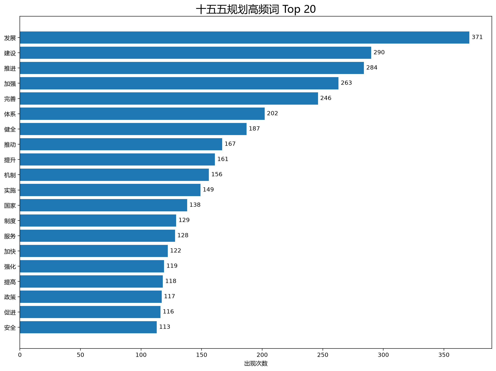

# “十五五”发展规划热词频率统计实验总结

## 一、实验目的

本次实验主要是通过 Python 编写程序，对“十五五”发展规划文本进行中文分词和词频统计，了解规划文本中出现频率较高的词语，并使用图表展示统计结果。

通过本次实验，学习 Python 文件读取、中文分词、词频统计以及数据可视化的基本方法。

## 二、实验环境

- 操作系统：Windows
- 编程语言：Python 3.14
- 开发工具：Visual Studio Code
- 主要使用库：jieba、Pandas、Matplotlib、WordCloud
- 版本管理工具：Git、GitHub

## 三、实验过程

首先，我将“十五五”规划文本保存为 `data/plan.txt`，并通过终端检查文件是否成功保存。本次分析使用的文本共有 62,639 个字符。

接着，我使用 Python 编写 `main.py` 程序，先读取文本，再使用 jieba 对中文内容进行分词。为了提高分词效果，我添加了“高质量发展”“科技创新”“新质生产力”等自定义词语。

完成分词后，程序过滤掉单字、标点符号以及部分常见停用词，再通过 Counter 统计各词语出现的次数，并按照词频从高到低排序。

最后，使用 Pandas 将统计结果保存为 CSV 文件，使用 Matplotlib 绘制 Top 20 高频词柱状图，并使用 WordCloud 生成中文词云。

## 四、实验结果

程序成功完成了词频统计，并生成以下三个文件：

1. `results/word_frequency.csv`：完整词频统计表。
2. `images/top20_words.png`：前20个高频词柱状图。
3. `images/wordcloud.png`：中文词云图。

本次统计结果中，出现次数最多的五个词语为：

| 排名 | 词语 | 出现次数 |
|---|---|---:|
| 1 | 发展 | 371 |
| 2 | 建设 | 290 |
| 3 | 推进 | 284 |
| 4 | 加强 | 263 |
| 5 | 完善 | 246 |

从结果可以看出，“发展”“建设”“推进”等词语出现次数比较多，说明规划文本中包含较多关于发展目标、建设任务和推进措施的内容。

但词频结果也受到分词规则和停用词设置的影响，不能仅凭出现次数判断政策的重要程度。

### 1. 热词柱状图

### 2. 中文词云图

## 五、实验中遇到的问题

在实验过程中，我遇到的主要问题是创建文件夹时操作不正确，最初把 `images` 和 `results` 创建成了普通文件，导致程序运行时出现 `FileExistsError` 错误。

后来通过检查文件类型，将错误创建的文件重命名，再创建真正的文件夹，成功解决了问题。

另外，由于需要展示中文词语，我在程序中设置了 Windows 中文字体路径，避免柱状图和词云出现中文乱码。

通过这些问题，我认识到文件路径、文件类型和程序运行环境都会影响程序能否正常运行。

## 六、实验收获

通过本次实验，我进一步熟悉了 Python 在文本处理方面的应用，学习了如何使用 jieba 对中文文章进行分词，以及如何使用 Counter 统计词语出现次数。

在编写程序的过程中，我也练习了文件读取、循环、条件判断、列表和字典等基础知识。

以前我主要通过终端查看程序的运行结果，而这次实验让我学习了使用 Matplotlib 和 WordCloud 将统计数据转换成图表，使数据更加直观。

此外，在解决文件夹创建错误和检查图表显示效果的过程中，我也积累了一些调试经验，进一步熟悉了 VS Code 的操作。

## 七、实验总结

本次实验使用 Python 完成了“十五五”发展规划文本的热词频率统计，成功生成了前20个高频词柱状图、中文词云和 CSV 词频统计表。

通过本次实验，我对中文文本分析和数据可视化有了初步认识，也提高了自己使用 Python 完成实际编程任务的能力。